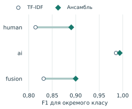
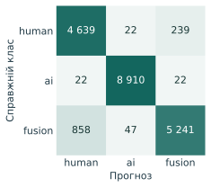

Найскладніше в цій задачі - помітити машинну вставку в людському тексті. Навіть у найкращої моделі 1 097 із 1 210 помилок припали на пару *human* і *fusion*. Повністю згенеровані документи (*ai*) вже базова модель розпізнавала з F1 0,9860.

## Дані та перевірка

Із 272 352 розмічених документів 44,8% належать до *ai*, 30,7% - до *fusion*, решта - до *human*. Щоб кожен клас мав однакову вагу, для порівняння моделей використано macro-F1. Усі моделі в підсумковій таблиці оцінено на тих самих 20 000 валідаційних документів. Окремі 50 000 текстів відведено для базових моделей, ще 20 000 - для ансамблю. Поділ враховував клас, мову й домен. Векторизатори й моделі навчалися на тренувальних рядках; валідація слугувала лише для оцінювання.

У людських уривках трапляються сліди обробки джерела, наприклад «U. S.» чи крапка з пробілами. У вставках мовної моделі оформлення зазвичай чистіше. На вибірці по 4 000 текстів кожного класу крапку з пробілами мали 22,2% людських, 16,6% змішаних і 5,8% згенерованих документів. За лексичним різноманіттям *fusion* теж опинився посередині, а за середньою довжиною речень мав найнижче значення.

## Експерименти

Для TF-IDF використано слова, пари слів і символьні послідовності довжиною 2-5 знаків. Дев’ять конфігурацій перевірено всередині навчальної вибірки (40 000/10 000). Тут ComplementNB дав macro-F1 0,5158-0,6558, а LinearSVC - 0,8536-0,8603. Серед варіантів логістичної регресії з C = 1, 4 і 16 вибрано C = 16 (0,8770). Зважування класів при C = 4 дало ті самі 0,8770.

У 63,1% текстів із вибірки для аналізу довжини було понад 510 токенів. Тому під час донавчання `xlm-roberta-base` із довгого документа щоразу брався випадковий фрагмент до 512 токенів зі службовими. Навчання тривало одну епоху на 50 000 текстах зі швидкістю $3 \times 10^{-5}$ та ефективним батчем 32 (4 × 8).

Прогноз лише за першими 512 токенами поступився TF-IDF (macro-F1 0,8370 проти 0,8773). Усереднення оцінок за фрагментами підняло результат до 0,8834. Для цього вікна формували з кроком 255 токенів і залишали до восьми вздовж документа.

## Де зріс F1



Найбільше виграли людські й змішані тексти. Для *human* приріст F1 становив 0,0761, для *fusion* - 0,0683.

## Фінальна модель

LightGBM поєднала прогнози TF-IDF зі статистиками оцінок XLM-R за фрагментами, мовою й доменом. Поправки для класів підібрано за прогнозами п’ятикратної перехресної перевірки на вибірці ансамблю. Вони підняли валідаційний macro-F1 з 0,9256 до 0,9280.

## Порівняння моделей

Фіксована валідація, 20 000 документів. У рядках із вагами перше число відповідає TF-IDF, друге - XLM-RoBERTa.

| Варіант | Macro-F1 | F1 human | F1 ai | F1 fusion |
|---|---:|---:|---:|---:|
| TF-IDF + логістична регресія | 0,8773 | 0,8144 | 0,9860 | 0,8316 |
| XLM-RoBERTa, перший фрагмент | 0,8370 | 0,7521 | 0,9858 | 0,7731 |
| XLM-RoBERTa, усереднення за фрагментами | 0,8834 | 0,8060 | 0,9906 | 0,8535 |
| TF-IDF і XLM-RoBERTa, ваги 30/70 | 0,9026 | 0,8415 | 0,9920 | 0,8742 |
| TF-IDF і XLM-RoBERTa, ваги 50/50 | 0,9054 | 0,8472 | 0,9927 | 0,8762 |
| Ансамбль із LightGBM | 0,9256 | 0,8852 | 0,9937 | 0,8977 |
| **Ансамбль із поправками для класів** | **0,9280** | **0,8905** | **0,9937** | **0,8999** |

## Які класи плутає ансамбль



Числа позначають документи, колір - частку в рядку. Модель віднесла 858 змішаних текстів до людських, а у зворотному напрямку помилилася 239 разів.

## Що вплинуло на прогноз

За SHAP найбільшу вагу в рішеннях ансамблю мали оцінка класу *ai* від TF-IDF і найнижча серед фрагментів оцінка *human* від XLM-R. Серед характерних для *fusion* пар слів є «let me» і «me know» із фрази «let me know», а також «missing part» і «missing section». У парламентському тексті вилучення речення зі словами «Let me know if you need further assistance with this scenario!» підвищило оцінку *human* на 0,10. У цьому прикладі джерело вставки видає звична завершальна репліка асистента. Такі сліди побудови датасету теж впливають на класифікацію.

Дані для таблиці й графіків: `results/experiments_val.csv` і `logs/ensemble_nolm.log`. Пояснення прогнозів: `results/shap_importance.csv` і `results/xai_sentences.html`.

## Запуск фінальної моделі

Встановіть залежності за `README.md`. У папці `solution/` послідовно виконайте команди:

```bash
python baseline_tfidf.py
python train_encoder.py --name xlmr_base --model xlm-roberta-base
python ensemble.py --enc xlmr_base --no_lm 1
```

Вибраний сабміт для Kaggle: `submissions/final_stack_bias.csv`.
